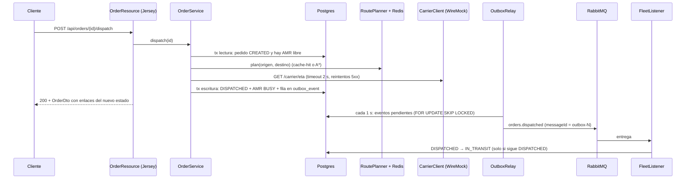
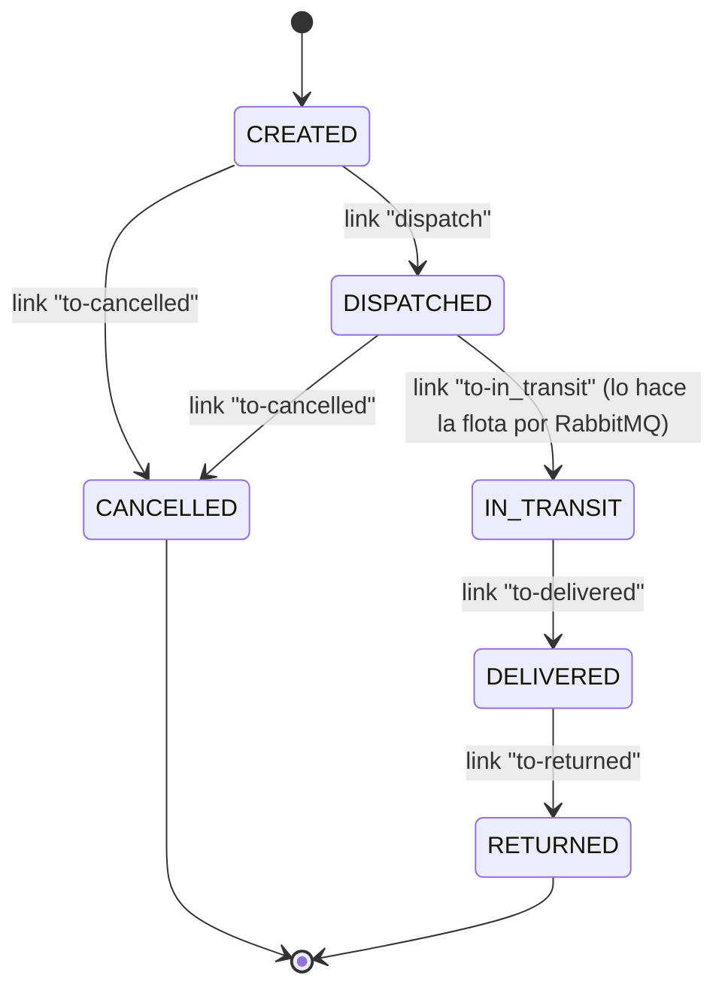

# Informe · Laboratorio API LOGISTPULSE

**Desarrollo de Software Moderno · USFQ** · Daniel Salazar · noviembre de 2026
Repositorio: <https://github.com/DanielSalazar0710/logistpulse-lab>

Trabajé en el **Modo B (stack completo)**: API + Postgres + Redis + RabbitMQ + WireMock + Prometheus + Grafana con
`docker compose`. No tengo JDK ni Maven instalados en mi equipo, así que las pruebas (`mvn test`) las corrí dentro del
contenedor oficial `maven:3.9-eclipse-temurin-21`. Cada parte tiene un script en `scripts/lab/` que reproduce la
demostración y las capturas están en la carpeta `evidencias/` de la entrega (también en el PDF).

| Parte | Qué hice | Commits |
|---|---|---|
| 0 | Recorrido, smoke test y pruebas base | `7e5a86d` |
| 1 | `GET /api/robots/{id}`, `DELETE /api/orders/{id}`, mapper de validación (+ mapper de query params) | `f5b1218`, `9f4331a`, `8035ccd` |
| 2 | Medición del N+1 e índice `idx_orders_status` | `db8d768` |
| 3 | `?customer=`, `?sort=` con lista blanca, enlaces que conservan filtros | `8035ccd` |
| 4 | Concurrencia, estado `RETURNED`, invariantes y **Flyway** (proyecto de cierre) | `ca887d1`, `deb68ff` |
| 5 | Costo 5 → 2, caché obsoleta, **retos**: 8 vecinos y clave de caché versionada | `ba33764`, `3c4cd1e` |
| 6 | ETA fuera de la transacción, **reto**: reintentos con backoff solo para 5xx | `5d9a23c`, `dc1eac5` |
| 7 | **Outbox**, consumidor idempotente, DLQ | `88fd22a`, `e2b1b9b` |
| 8 | Métricas HTTP de Jersey, p95, caos, SLOs, **reto**: gauge por estado y alertas | `7cd814d` … `8adbe32` |
| 9 | Postman (+5 tests), Mockito, prueba con contexto Spring, **reto**: healthcheck | último commit |

---

## Parte 0 · Recorrido

**Flujo de `POST /api/orders/{id}/dispatch`** (versión final, después de los cambios de las partes 6 y 7):

En el código original todo ocurría dentro de una sola `@Transactional` (incluida la llamada HTTP) y el evento se
enviaba en `afterCommit`. `scripts/smoke.sh` y `mvn test` pasaron completos (10 pruebas) antes de tocar nada
(evidencias 00 y 01).

**★ ¿Qué papel juega `JerseyConfig`?** Es el `ResourceConfig` de Jersey: la aplicación JAX-RS. Spring Boot con Jersey
no escanea `@Path` por su cuenta, así que ahí se registran explícitamente los recursos (`OrderResource`,
`RobotResource`, …) y los `ExceptionMapper`. Con `spring.jersey.application-path=/` Jersey atiende `/api/**` y también
`/actuator/**`. **Si olvido registrar un recurso**, la aplicación arranca sin errores, pero sus rutas responden **404**
porque Jersey no las conoce. Si olvido un mapper, la excepción no se traduce y el cliente recibe un 500 (página HTML de
Tomcat). Me pasó con los mappers nuevos: cada uno lo tuve que añadir en `JerseyConfig`.

## Parte 1 · Jersey / JAX-RS

1. `GET /api/robots/{id}` → `RobotService.get` lanza `ApiException(404)` si no existe.
2. `DELETE /api/orders/{id}` → 204 si está `CREATED`, 409 en cualquier otro estado y 404 si no existe. Solo permito
   borrar mientras el pedido no ha comprometido recursos (AMR, eventos).
3. `ConstraintViolationMapper` → 400 con `fields: [{field, message, rejected}]`. El nombre del campo sale del último
   nodo del `propertyPath` (`create.arg0.customer` → `customer`). Puse los mensajes de validación en español.
4. Extra: `ParamExceptionMapper`. JAX-RS responde **404** cuando un `@QueryParam` no se puede convertir
   (`?status=FOO`), lo que confunde al cliente porque el recurso sí existe. Lo traduje a **400**.

Evidencia 02.

**★ Equivalencias con Spring MVC**

| JAX-RS / Jersey | Spring MVC |
|---|---|
| `@QueryParam("x")` | `@RequestParam("x")` |
| `@PathParam("id")` | `@PathVariable("id")` |
| `@Context UriInfo` | `UriComponentsBuilder` / `ServletUriComponentsBuilder` inyectado en el método (o `HttpServletRequest`) |
| `ExceptionMapper<E>` | `@ExceptionHandler(E.class)` dentro de un `@RestControllerAdvice` (o `ProblemDetail`) |
| `Response.created(uri)` | `ResponseEntity.created(uri)` |

## Parte 2 · JPA e Hibernate

Con `spring.jpa.show-sql=true` medí `GET /api/orders?size=10` (script `parte2.sh`; excluyo los `count(robot)` que
dispara Prometheus cada 5 s al leer los gauges):

| Variante | Consultas | Detalle |
|---|---|---|
| Con `@EntityGraph(warehouse, robot)` | **2** | 1 `select … from orders left join robot join warehouse` + 1 `count` |
| Sin `@EntityGraph` | **5** | 1 select de pedidos + 1 `count` + 1 `warehouse` + **1 por cada AMR distinto** (2 en esa página) |

**★ ¿Por qué?** `warehouse` y `robot` son `@ManyToOne(fetch = LAZY)`. Sin el grafo, Hibernate trae solo los pedidos y
deja proxies; `OrderDto.from` llama a `getWarehouse().getName()` y `getRobot().getCode()`, y cada proxy sin inicializar
dispara su propio `select`. Es el problema **N+1**: 1 consulta para la lista + N para las relaciones. No son 10 + 10
porque el contexto de persistencia reutiliza entidades ya cargadas: el almacén es uno solo y varios pedidos comparten
AMR. Con 100 pedidos y 50 AMR distintos serían 52 consultas por página. El `@EntityGraph` lo resuelve con un `join`
en una sola consulta (evidencias 03 y 04).

**Índice.** `@Table(indexes = @Index(name = "idx_orders_status", columnList = "status"))`. Lo justifico así: el filtro
más usado del listado es `?status=` y las invariantes de la flota se consultan por estado. La tabla solo crece (los
`DELIVERED` no se borran) y sin índice cada filtro sería un recorrido completo de la tabla. La selectividad es buena
para los estados "vivos" (`CREATED`, `DISPATCHED`, `IN_TRANSIT`), que son pocos frente al histórico. La búsqueda de
`?customer=` (contiene) no se beneficiaría de un B-tree por el comodín inicial; para eso haría falta `pg_trgm`.

## Parte 3 · Spring Data, paginación y HATEOAS

1. `?customer=` con métodos derivados `findByCustomerNameContainingIgnoreCase` y
   `findByStatusAndCustomerNameContainingIgnoreCase`, también con `@EntityGraph` para no reintroducir el N+1.
2. `?sort=campo,dir` validado contra una **lista blanca** (`id, code, customer, status, createdAt, eta`) que traduce el
   nombre público al de la entidad (`customer` → `customerName`). Si el campo no está en la lista, responde 400 con
   los campos permitidos. Siempre agrego `id desc` como desempate para que la paginación sea estable. Los enlaces
   `self/first/prev/next/last` conservan `status`, `customer` y `sort` (evidencia 05).

**★ Grafo de estados con los enlaces que ofrece cada uno** (incluye `RETURNED` de la Parte 4):

Todos los estados llevan además `self` y `collection`. `CANCELLED` y `RETURNED` son terminales, así que no ofrecen
ninguna transición. El cliente no necesita conocer la máquina de estados: solo sigue los enlaces que recibe.

**Reto · ¿por qué `size` se limita a 100 en el servicio y no solo en el recurso?** Porque el servicio es la frontera
que protege la base de datos y la memoria, y tiene más de un cliente: el recurso REST, el `FleetListener`, pruebas o un
futuro endpoint GraphQL o batch. Si el límite viviera solo en `OrderResource`, cualquier otro llamador podría pedir
`size=1000000` y cargar la tabla entera. Es la regla de "validar en el dominio, no solo en el borde". Lo dejé como
constante pública `OrderService.MAX_PAGE_SIZE` y la demo muestra que `size=500` se aplica como 100.

## Parte 4 · Máquina de estados y concurrencia

**4.1 `RETURNED`.** Añadí `RETURNED` (solo desde `DELIVERED`, terminal) y amplié `OrderStatusTest` con **5 casos
nuevos** (9 en total): solo `DELIVERED` puede devolverse, `RETURNED` es terminal, no se puede volver a entregar ni
cancelar, y ningún estado regresa a `CREATED`.

**Hallazgo:** en Postgres la transición fallaba con **500**:
`violates check constraint "orders_status_check"` (evidencia 07). Hibernate 7 genera un `CHECK` con los valores del enum
al crear la tabla, y `ddl-auto=update` **nunca modifica un CHECK existente**. El enum y la base quedaron
desincronizados. Esto motivó el **proyecto de cierre con Flyway** (ver más abajo, ADR-001): `V2__estado_returned.sql`
reemplaza el CHECK y además agregué `DataIntegrityMapper` para que una violación de integridad responda **409 en
JSON** y no una página HTML 500 (evidencia 08).

**4.2 ★ Concurrencia.** Lancé dos despachos simultáneos del mismo pedido 5 veces (evidencia 06):

- **Gana** la transacción que hace *commit* primero. El pedido queda `DISPATCHED` con su AMR.
- **El perdedor** leyó el pedido con la misma `@Version` (0). Al hacer `UPDATE … WHERE id=? AND version=0` no actualiza
  ninguna fila, Hibernate lanza `OptimisticLockException`, Spring la traduce a
  `ObjectOptimisticLockingFailureException` y `OptimisticLockMapper` responde **409 "Conflicto de concurrencia,
  reintenta la operación"**. Si el perdedor llega cuando el ganador ya confirmó, recibe 409 "Transición ilegal
  DISPATCHED → DISPATCHED" (la máquina de estados lo frena antes).
- **Dos pedidos distintos a la vez** (5 intentos): ambos eligen el primer AMR libre (`AMR-01`). El segundo commit falla
  por la `@Version` de **`Robot`** y responde 409, así que **nunca** dos pedidos se quedaron con el mismo AMR. El costo
  es un "falso conflicto": el segundo pedido se rechaza aunque había otros 4 AMR libres, y el cliente debe reintentar.
  Una mejora sería reintentar automáticamente en el servicio, o elegir el AMR con `SELECT … FOR UPDATE SKIP LOCKED`.

**4.3 Invariantes del sistema**

| # | Invariante | ¿Quién la garantizaba al inicio? | Ahora |
|---|---|---|---|
| I1 | Un pedido `DISPATCHED`/`IN_TRANSIT` tiene AMR asignado | Solo el código | **Base de datos** (`ck_orders_mision_con_robot`) |
| I2 | Un pedido `CREATED` no tiene AMR | Solo el código | **Base de datos** (`ck_orders_created_sin_robot`) |
| I3 | Un AMR tiene como máximo **un** pedido en misión | `@Version` de `Robot` (optimista) | **Base de datos** (índice único parcial `ux_orders_robot_en_mision`) |
| I4 | Un AMR `BUSY` tiene **exactamente** un pedido en misión (y uno `IDLE`, ninguno) | Solo el código | **No garantizada por la base**: cruza dos tablas; requeriría un trigger o derivar `BUSY` del pedido |
| I5 | Batería entre 0 y 100 | `Robot.setBattery` (clamp) | **Base de datos** (`ck_robot_bateria`) |
| I6 | Las transiciones siguen el grafo de estados | `OrderStatus.canGoTo` | Solo el código (un CHECK no conoce el estado anterior; haría falta un trigger) |
| I7 | El estado pertenece al enum | CHECK generado por Hibernate (desactualizado) | **Base de datos**, versionado con Flyway (V2) |
| I8 | Código de pedido único | `existsByCode` + UNIQUE | UNIQUE (la comprobación previa sola tendría una carrera) |

La evidencia 08 muestra a Postgres rechazando I1, I3 e I5 incluso con `UPDATE` directos que se saltan la API.

## Parte 5 · Rutas A\*, Redis y métricas

1. Comparé rutas en el plano (evidencia 09, dibujadas con `scripts/lab/plano.py`). Con costo 5, de (3,3) a (7,3) A\*
   **rodea** la zona por la fila 2 (costo 6) en vez de cruzarla (16). Hacia un destino dentro de la zona (5,4), entra por
   el borde más barato.
2. **★ ¿Por qué el contador solo sube la primera vez?** `RoutePlanner.plan` tiene `@Cacheable("routes")` y el `Timer`
   está *dentro* del método. La primera petición es un *cache-miss*: se ejecuta A\*, se mide y el resultado se guarda en
   Redis con la clave `routes::0:0>10:5` (TTL 600 s). La segunda la resuelve el proxy de caché **sin entrar al
   método**, así que el Timer no se entera. Por eso `logistpulse_route_plan_seconds_count` cuenta cálculos reales, no
   peticiones.
3. Cambié el costo de la zona a **2** (`WarehouseGrid.CONGESTED_COST`) y actualicé `AStarPathfinderTest`. Ahora de
   (4,4) a (6,4) conviene **cruzar** (2+2 = 4) en lugar de rodear (5). Antes era al revés (10 contra 8).
   **★ ¿Sigue siendo admisible Manhattan?** Sí. Una heurística es admisible si nunca sobreestima el costo real. Cada paso
   cuesta como mínimo 1 y Manhattan cuenta exactamente el número mínimo de pasos, así que `h ≤ costo real` mientras
   el costo mínimo de una celda sea ≥ 1. **Con costo mínimo 0,5 dejaría de serlo**: dos celdas de 0,5 cuestan 1 y
   Manhattan diría 2. A\* podría devolver rutas no óptimas. La corrección es escalar la heurística por el costo mínimo:
   `h = 0,5 · Manhattan`.
4. **Reto · diagonales.** `AStarPathfinder(grid, true)` usa 8 vecinos con costo `√2 · costo de la celda` y la
   heurística **octil** `(dx+dy) + (√2−2)·min(dx,dy)`, admisible con costo mínimo 1. No permito "cortar esquinas": una
   diagonal exige que las dos celdas ortogonales estén libres. Lo expuse como `GET /api/routes?…&diagonal=true`. De
   (0,0) a (11,7) pasa de 18 pasos con costo 18 a 15 pasos con costo 16 (evidencia 11). Agregué 5 pruebas: costo √2 en
   piso abierto, nunca más caro que 4 vecinos, sin cortar esquinas, la heurística nunca sobreestima y la versión del
   plano.
5. **Reto · la caché nunca se invalida.** Lo comprobé en vivo (evidencia 10): después de cambiar el costo a 2 y
   redesplegar, Redis seguía devolviendo la ruta calculada con costo 5 (costo 8, rodeando). Solo al borrar la clave
   apareció la correcta (costo 4, cruzando). Estrategias:
   - **TTL** (ya existía, 10 min): acota cuánto dura el error, pero no lo evita.
   - **Versión del plano en la clave** (lo implementé): `WarehouseGrid.version()` es una huella de las filas y de
     `CONGESTED_COST`, y la clave queda `routes::300fc262:4:0:0>11:7`. Si cambia el plano o un costo, cambia la clave y
     las rutas viejas ya no se leen; el TTL las limpia después. No hace falta coordinar a nadie.
   - **`@CacheEvict(cacheNames="routes", allEntries=true)`** en la operación que edite el plano, cuando el plano sea
     editable en tiempo de ejecución (por ejemplo, un pasillo bloqueado por un derrame). Con varias réplicas el
     *evict* en Redis compartido llega a todas.

## Parte 6 · RestClient y resiliencia

1. **★ `LP-SLOW…`**: WireMock tarda 5 s y `CarrierClient` corta a los 2 s (`setReadTimeout`). El ETA que queda es el
   **local**: `route.cost() * 2` = 9 · 2 = **18 min**. El log sí avisa:
   `WARN … Transportista no disponible para LP-SLOW…: I/O error … Request cancelled`. Pero el aviso solo quedaba en el
   log. Agregué la métrica `logistpulse_carrier_fallback_total` para que la degradación se vea en Grafana (evidencia 12).
2. Con el transportista apagado: 200 en ~1 s (`connectTimeout` de 1 s) y ETA local (evidencia 12).
3. **★ Trampa deliberada.** `dispatch` hacía la llamada HTTP dentro de la `@Transactional`. Lo medí en Postgres:
   durante los 2 s de espera la conexión aparecía como **`idle in transaction`** (evidencia 12). Riesgos:
   - la conexión de Hikari queda retenida todo ese tiempo: con 10 conexiones en la pool bastan 10 despachos lentos
     para que el resto de la API espere conexión y falle por timeout (agotamiento de la pool);
   - la transacción abierta mantiene *snapshots* y bloqueos de fila más tiempo, lo que aumenta los conflictos y el
     trabajo de Postgres;
   - un fallo de red puede dejar la transacción abierta hasta el timeout.

   **Refactor** en tres fases (`OrderService.dispatch` con `TransactionTemplate`): (1) transacción corta de solo
   lectura que valida el estado y que haya AMR, y falla rápido sin tocar la red; (2) **sin transacción**: ruta y ETA;
   (3) transacción corta de escritura que **vuelve a validar**, porque el mundo pudo cambiar durante la fase 2, toma el
   AMR y guarda. La `@Version` sigue protegiendo la concurrencia. Después del cambio, durante la llamada lenta
   **no hay ninguna transacción abierta** (evidencia 13).
4. **Reto · reintentos.** `CarrierClient` reintenta **solo 5xx**, como máximo 2 veces con backoff exponencial (200 ms,
   400 ms). **No** reintenta 4xx (un error de la petición se repetiría igual) ni timeouts (ya costaron 2 s; reintentar
   triplicaría la latencia y cargaría más a un servicio saturado). Lo probé con mappings nuevos de WireMock
   (evidencia 14):

   | Caso (código) | Llamadas al transportista | Resultado |
   |---|---|---|
   | `LP-FLAKY…` (503 y luego 200, escenario de WireMock) | 2 | ETA real **31** tras 1 reintento |
   | `LP-FAIL…` (503 siempre) | 3 | ETA local tras 2 reintentos (~0,6 s) |
   | `LP-BAD…` (404) | **1** | ETA local, sin reintentar |

## Parte 7 · Mensajería, consistencia y Outbox

1. Flujo normal: `Evento order.dispatched publicado` → `Flota recibió order.dispatched` → `IN_TRANSIT` (evidencia 16).
2. Para detener el consumidor sin tocar el código agregué `@RabbitListener(autoStartup = "${lab.fleet.auto-startup}")`
   y lo controlo con la variable `FLEET_AUTO_STARTUP=false`. Despaché 3 pedidos: **3 mensajes `ready`, 0 consumidores** y
   3 pedidos `DISPATCHED` (evidencias 16 y 17). Al reactivarlo los procesó y la cola volvió a 0.
3. **★ ¿Qué fallo evita `afterCommit` y cuál sigue existiendo?** Evita publicar un evento de algo que **no llegó a
   confirmarse**: si se publicara dentro de la transacción y luego hubiera *rollback*, la flota actuaría sobre un
   pedido que no está despachado (o que no existe). **Sigue existiendo** la ventana entre el commit y el envío. Si el
   proceso cae ahí o el broker no responde, el pedido queda `DISPATCHED` con su AMR ocupado y el evento se pierde para
   siempre. Lo reproduje apagando RabbitMQ (evidencia 15): el cliente recibió **500**, pero el pedido quedó
   `DISPATCHED` con AMR-01 y **nunca** pasó a `IN_TRANSIT`. Es el peor caso: el cliente cree que falló y el sistema
   cree que sí ocurrió.
4. **Outbox** (`V4__outbox.sql`, `OutboxEvent`, `OutboxRelay`). `DispatchEventPublisher.publish` ahora inserta una fila
   en `outbox_event` **en la misma transacción** que el cambio de estado (`Propagation.MANDATORY`), y un `@Scheduled`
   cada 1 s toma los pendientes con `FOR UPDATE SKIP LOCKED` (seguro con varias réplicas), los publica con
   `messageId = outbox-N` y los marca `sent_at`. Con RabbitMQ caído (evidencia 18) el despacho responde **200**, el
   evento espera en la tabla (`logistpulse_outbox_pending = 1`) y, al volver el broker, el relay lo publica (en ese
   caso, al intento 8) y el pedido pasa a `IN_TRANSIT`. Agregué `spring.rabbitmq.connection-timeout=2s`: sin eso, con
   el broker caído el relay quedaba bloqueado hasta 60 s.
   Compromiso: el relay publica dentro de su propia transacción para mantener el bloqueo de las filas; el envío a un
   broker local es rápido y está acotado por ese timeout.
5. **★ Idempotencia.** Con Outbox la entrega es "**al menos una vez**": si el relay publica y cae antes de marcar
   `sent_at`, el evento se reenvía. **Hoy (antes del cambio)**, un `IN_TRANSIT` repetido hacía que `transition` lanzara
   "Transición ilegal IN_TRANSIT → IN_TRANSIT". El listener fallaba, el mensaje volvía a la cola y se reentregaba sin
   fin: medí **2.991 entregas en 5 s** del mismo mensaje (evidencia 15), un *poison message* que consume CPU y llena el
   log. **Solución:** `OrderService.startTransitIfDispatched` hace la transición **solo si el pedido sigue
   `DISPATCHED`** y devuelve `false` sin excepción si no. El listener confirma el mensaje, lo registra como duplicado y
   cuenta `logistpulse_fleet_duplicates_total`. Procesar el evento N veces deja el mismo resultado que procesarlo una.
   Además, para errores que no son duplicados (un payload corrupto), configuré reintentos acotados del listener y
   `default-requeue-rejected=false` con una **dead-letter queue** `orders.dispatched.dlq`: el mensaje venenoso se intenta
   4 veces y queda aparcado en la DLQ, sin bucle (evidencia 18).

## Parte 8 · Observabilidad y "guerra de resiliencia"

**Problemas que encontré en el dashboard entregado y corregí:**
- El panel "HTTP: peticiones/s por estado" salía **vacío**: con Jersey, Spring Boot 4 no publica `http_server_requests`
  a menos que esté `org.glassfish.jersey.ext:jersey-micrometer` en el classpath. Lo agregué al `pom.xml`.
- La serie "creados" del primer panel tampoco aparecía: el contador `logistpulse.orders.created` se exporta como
  `logistpulse_orders_total`, porque Prometheus/OpenMetrics reserva el sufijo `_created`. Lo renombré a
  `logistpulse.orders.registered`.

1. Generé carga (40 pedidos y 60 rutas aleatorias) y el dashboard la muestra (evidencias 19 y 20).
2. **★ Flota agotada.** Al despachar el 6.º pedido con los 5 AMR ocupados se recibe **409** `"No hay AMR disponible
   (libre y con batería ≥ 20%)"`. Lo muestran el panel **"AMR libres" en 0** (y "AMR en misión" en 5) y la serie
   **409** del panel HTTP. Además, la alerta **`SinAMRLibres`** pasó a *firing* después de 1 minuto (evidencia 21).
   Se recupera entregando pedidos y cargando baterías con `POST /api/robots/{id}/charge`.
3. **Caos** (`scripts/lab/parte8-caos.sh`, una dependencia a la vez; evidencias 22 y 23):

   | Experimento | Qué pasó | Panel / señal que cambia | Recuperación |
   |---|---|---|---|
   | `stop rabbitmq` → despachar | **200** (Outbox), el pedido queda `DISPATCHED`, `/actuator/health` en 503 (`rabbit` DOWN) | "Mensajería": outbox pendiente 1; seg. en DISPATCHED crece | **7 s** desde el `start` hasta publicar y pasar a `IN_TRANSIT` |
   | `stop redis` → rutas (**antes**) | **500 después de 60 s** en rutas *y en despachos*: la caché era un punto único de fallo | HTTP 500; p95 por las nubes | 24 s |
   | `stop redis` → rutas (**después**) | ruta **200 en 0,008 s** y despacho **200 en 0,15 s**; solo `/actuator/health` marca 503 | `logistpulse_cache_errors_total` y el WARN de `CacheConfig` | 1 s |
   | `stop carrier-mock` → despachar | 200 en ~2 s con ETA local (30) | "ETA local / min" en el panel de mensajería | 1 s |
   | `stop db` → `/actuator/health` (**antes**) | 503 con `db: DOWN` tras **30 s** (timeout de Hikari); la API responde 500 tras 30 s | HTTP 500/503; el scrape de Prometheus se vuelve lento | 9 s (Hikari reconecta solo) |
   | `stop db` (**después**) | 503 y 500 en **3 s** | igual, pero sin hilos colgados | 0–2 s |

   **Arreglo de Redis**, en dos pasos. Primero `CacheConfig`: un `CacheErrorHandler` que trata cualquier error de la
   caché como *cache-miss*, lo registra y lo cuenta, más timeouts de Redis de 300 ms. Con eso las rutas ya respondían
   200, pero tardaban ~9 s: con el contenedor apagado el nombre `redis` deja de resolverse en el DNS de Docker y cada
   lectura y escritura esperaba el timeout de la resolución. Segundo, `GuardedCache`: un **cortacircuitos** mínimo que,
   tras el primer fallo, deja de tocar Redis durante 15 s (la caché se comporta como vacía) y luego vuelve a probar.
   La caché es una optimización: no puede tumbar los despachos. También bajé el `connection-timeout` de Hikari a 3 s
   para que, sin base de datos, la API falle rápido en lugar de colgar los hilos 30 s.
4. Agregué el panel **"Latencia p95 por endpoint"** con
   `histogram_quantile(0.95, sum by (le, method, uri) (rate(http_server_requests_seconds_bucket{uri=~"/api/.*"}[1m])))`
   y activé `management.metrics.distribution.percentiles-histogram.http.server.requests=true`.
5. **★ SLOs** (también como reglas de alerta en `infra/prometheus/alerts.yml`):

   | SLO | Objetivo | PromQL (SLI) |
   |---|---|---|
   | Disponibilidad del despacho | ≥ 99,5 % de despachos sin 5xx en 30 días (los 409 de negocio no cuentan como indisponibilidad) | `1 - (sum(rate(http_server_requests_seconds_count{uri="/api/orders/{id}/dispatch",status=~"5.."}[30d])) / sum(rate(http_server_requests_seconds_count{uri="/api/orders/{id}/dispatch"}[30d])))` |
   | Latencia del despacho | p95 < 500 ms (ventana de 5 min) | `histogram_quantile(0.95, sum by (le) (rate(http_server_requests_seconds_bucket{uri="/api/orders/{id}/dispatch"}[5m])))` |
   | Tiempo máximo en `DISPATCHED` | Ningún pedido más de 60 s en `DISPATCHED` | `max_over_time(logistpulse_orders_dispatched_oldest_age_seconds[5m]) < 60` |

   Para el tercero no existía la métrica, así que la creé: columna `dispatched_at` (`V5__dispatched_at.sql`) y el gauge
   `logistpulse_orders_dispatched_oldest_age_seconds`, la antigüedad del despacho más viejo que sigue en `DISPATCHED`.
   Es justo lo que habría delatado el evento perdido de la Parte 7.3, porque ese valor crece sin parar.
6. **Reto.** Gauge `logistpulse_orders_by_status{status=…}` (panel "Pedidos por estado") y alerta **"AMR libres = 0
   durante 1 minuto"** (`SinAMRLibres`, `for: 1m`), que se ve disparada en la evidencia 21. También están las alertas
   de los tres SLOs.

## Parte 9 · Pruebas y contenedores

1. **Postman.** Agregué tests a la colección y la corrí con **Newman** en Docker (evidencia 24):
   - esquema `PageDto` del listado con `pm.response.to.have.jsonSchema` (código + esquema);
   - `Location` igual al `links.self` del pedido creado, con estado `CREATED` y enlace `dispatch`;
   - esquema del pedido despachado (AMR `^AMR-`, ETA ≥ 1 y sin enlace `dispatch`);
   - dos peticiones nuevas: validación 400 con la lista de campos y robot inexistente 404.
2. **Mockito** (`OrderServiceTest`, 6 pruebas, sin Spring ni base de datos): sin robots → 409 *y no se llama al
   transportista*; pedido ya despachado → 409; transportista caído → ETA = `route.cost() * 2` y se cuenta el
   *fallback*; ETA del transportista cuando responde; duplicado ignorado; lista blanca de orden. Agregué también
   `LabApplicationTests` con el **contexto completo de Spring** en modo lite: valida que las migraciones Flyway de H2
   coinciden con las entidades y que el despacho deja su evento en el outbox. Total: **29 pruebas, todas verdes**
   (evidencia 25).
3. **★ Dockerfile.**
   - **¿Por qué dos etapas?** La primera (`maven:3.9-eclipse-temurin-21`) compila con JDK y Maven. La segunda
     (`eclipse-temurin:21-jre`) solo copia `app.jar`. La imagen final no lleva Maven, el código fuente, el `~/.m2` ni el
     JDK: pesa mucho menos, arranca y se descarga más rápido y tiene menos superficie de ataque.
   - **¿Qué se cachea con `dependency:go-offline`?** Se copia primero solo el `pom.xml` y se descargan todas las
     dependencias en una capa propia. Docker reutiliza esa capa mientras el `pom.xml` no cambie, así que al editar solo
     código fuente no se vuelve a bajar nada. Lo comprobé: cada *rebuild* de la API tardó ~1 min, y solo los que
     cambiaron el `pom.xml` (Flyway, jersey-micrometer) volvieron a descargar.
   - **¿Por qué `USER appuser`?** Para no ejecutar la JVM como root. Si alguien explota una vulnerabilidad de la
     aplicación, obtiene un usuario sin privilegios dentro del contenedor y le cuesta más escalar al host o a otros
     contenedores (principio de mínimo privilegio).
4. **Reto · healthcheck.** La guía asume que la imagen JRE no trae `curl`. Lo revisé y la versión actual de
   `eclipse-temurin:21-jre` **sí** trae `curl` y `wget` (evidencia 26), pero no quise depender de eso: una imagen más
   mínima (Alpine, *distroless*) los quitaría. Solo uso `bash`: `/dev/tcp` abre el socket y envío una petición HTTP/1.0
   a mano. Apunto a **`/actuator/health/liveness`** (activé las *probes*) y no a
   `/actuator/health`, porque si Redis o RabbitMQ caen la API sigue viva y no debe marcarse *unhealthy* ni reiniciarse
   por una dependencia externa. Prometheus ahora espera `condition: service_healthy` (evidencia 26).

---

## Proyecto de cierre · ADR-001: Flyway en lugar de `ddl-auto=update`

- **Contexto.** Al añadir `RETURNED` la API respondió 500 en Postgres: el `CHECK` que Hibernate generó al crear la
  tabla no incluía el nuevo valor y `ddl-auto=update` nunca lo actualiza. Además, las invariantes de la Parte 4.3 solo
  vivían en el código Java.
- **Decisión.** El esquema lo gobierna **Flyway** (`db/migration/{vendor}`, con scripts para PostgreSQL y para H2) y
  Hibernate pasa a `ddl-auto=validate`. Para la base que ya existía uso `baseline-on-migrate` con `baseline-version=1`:
  se marca como V1 sin ejecutarla y se aplican V2 en adelante. Lo probé sobre mis datos reales sin perder nada
  (evidencia 08).

  | Versión | Contenido |
  |---|---|
  | V1 | Esquema inicial (equivalente al que generaba Hibernate) |
  | V2 | CHECK de estado con `RETURNED` |
  | V3 | Invariantes I1, I2, I3 (índice único parcial), I5 y destino ≥ 0 |
  | V4 | Tabla `outbox_event` + índice parcial de pendientes |
  | V5 | Columna `dispatched_at` para el SLO 3 |
- **Alternativas.** Seguir con `update` (descartada: no evoluciona restricciones ni se puede revisar en un PR);
  Liquibase (válida, pero Flyway con SQL plano es más simple y legible para este tamaño); un trigger para I4 e I6
  (pospuesto: agrega lógica en la base que hoy cubren el código y el bloqueo optimista).
- **Consecuencias.** (+) El esquema se versiona, se revisa en los PR y es reproducible en cualquier ambiente; las
  invariantes críticas las garantiza Postgres aunque alguien se salte la API. (−) Cada cambio de entidad exige su
  migración, y `validate` hace fallar el arranque si se olvida. (−) El índice único parcial no existe en H2, así que en
  modo lite I3 la cuida solo la `@Version`.

## Deuda técnica que queda

- El "falso conflicto" de la Parte 4.2: el segundo despacho simultáneo recibe 409 aunque haya otros AMR libres.
- I4 (`BUSY` ⇔ exactamente un pedido en misión) e I6 (grafo de transiciones) no están en la base.
- Un evento perdido *antes* del Outbox (pedidos que quedaron atascados en la evidencia 15) no se recupera solo. Haría
  falta una tarea de reconciliación que cancele o reencole los `DISPATCHED` viejos; la alerta `PedidoAtascadoEnDispatched`
  al menos los detecta.
- `/actuator/health` agregado marca DOWN si cae Redis o RabbitMQ. Está bien para un tablero, pero para un *readiness*
  real separaría las dependencias críticas (base de datos) de las degradables (caché).

## Uso de IA

Usé Claude Code como apoyo durante el laboratorio: para levantar el entorno en Docker, revisar el código, implementar y
depurar los cambios, automatizar las capturas y redactar este informe. Revisé y ejecuté cada cambio y cada prueba en mi
equipo; las evidencias son capturas reales de esas ejecuciones.
